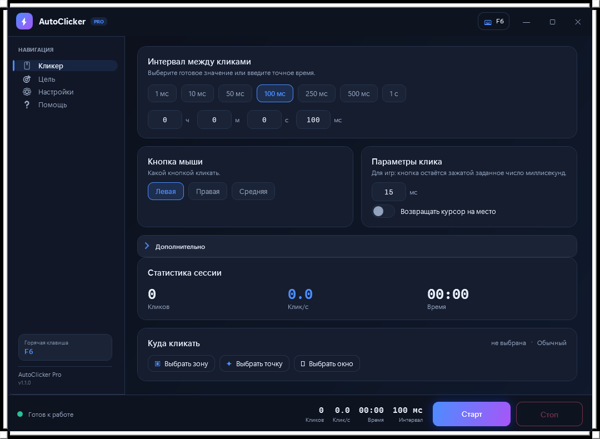

# AutoClicker Pro

Быстрый и аккуратный автокликер для Windows: темы интерфейса, фоновый и игровой режимы,
точный таймер и понятная статистика.

A fast and good-looking auto clicker for Windows: UI themes, background and game modes,
high-precision timing and clear stats.



## Возможности / Features

- **9 готовых тем + своя палитра.** Тема применяется мгновенно, свои цвета можно
  сохранять и загружать. / 9 built-in themes plus a custom palette that can be saved.
- **Горячая клавиша с модификаторами** (`Ctrl+Alt+F7`, `F6`, ...). Программа проверяет,
  не занята ли комбинация, и не теряет старую клавишу при неудаче.
  / Modifier-aware global hotkey with collision checks.
- **Три режима:** обычный (SendInput), фоновый (клики прямо в окно, курсор не двигается)
  и игровой (активация окна + удержание кнопки).
  / Three modes: foreground, background and game.
- **Цель:** зона на экране, одна точка или конкретное окно. / Zone, point or window.
- **Точный интервал** от 1 мс без «плавающих» 15 мс: отдельный поток, `timeBeginPeriod`,
  компенсация отставания. / Precise timing from 1 ms in a dedicated thread.
- **Дополнительно:** циклический режим, рандомизация координат, «человеческая» задержка,
  лимит кликов и лимит времени. / Cyclic mode, randomization, human-like delay, limits.
- **Статистика:** количество кликов, CPS и время сессии. / Clicks, CPS and uptime.
- **RU / EN** с переключением на лету, без перезапуска. / Live language switching.
- **Мелочи:** сворачивание в трей, «поверх всех окон», прозрачность, плавная прокрутка,
  автосохранение настроек. / Tray, always-on-top, opacity, smooth scrolling, auto-save.
- **Один exe:** зависимости вшиваются через Costura.Fody. / Single exe via Costura.Fody.

## Как запустить / How to run

1. Скачайте `AutoClicker.exe` из раздела **Releases** (или соберите сами, см. ниже).
2. Запустите. Если SmartScreen предупреждает — «Подробнее» → «Выполнить в любом случае»
   (приложение без цифровой подписи). / If SmartScreen warns: More info → Run anyway.
3. Настройте и нажмите **Старт**. / Configure and press Start.

## Фоновый режим / Background mode

1. Вкладка **«Цель»** → **«Выбрать окно»**, затем кликните по нужному окну (даётся 10 секунд).
2. При необходимости выберите зону или точку внутри него.
3. Включите режим **«Фоновый»** и нажмите «Старт».

Клики отправляются в окно через `PostMessage` и работают даже если оно свёрнуто или
перекрыто. Браузеры, лаунчеры и старые игры — да; современные игры с Raw Input такие
сообщения обычно игнорируют.

/ Clicks are delivered with `PostMessage`, so the window may be minimized. Browsers and
launchers work; Raw Input games usually ignore these messages.

## Игровой режим / Game mode

Активирует выбранное окно и кликает через `SendInput` с настраиваемым удержанием
(15–50 мс). Работает в оконном и безрамочном режиме. В эксклюзивном полноэкранном
режиме игра может блокировать чужие клики — переключите её в оконный/безрамочный режим.

/ Activates the target window and clicks with SendInput plus a configurable hold.
Use windowed or borderless mode; exclusive fullscreen may block synthetic input.

> ⚠️ **Античит.** В онлайн-играх автоматизация запрещена правилами и может привести к
> блокировке аккаунта. Используйте на свой риск.
> **Anti-cheat.** Automation is against the rules in online games and may lead to a ban.

## Сборка из исходников / Build from source

Требования:

- Windows 10/11
- Visual Studio 2022 с рабочей нагрузкой **«Разработка классических приложений .NET»**
  (.NET desktop development)
- .NET Framework 4.7.2 Developer Pack
- NuGet (Visual Studio восстановит пакеты сам)

```bash
git clone https://github.com/AlexMDLL/AutoClicker.git
cd AutoClicker
```

Откройте `AutoClicker.sln`, дождитесь восстановления NuGet-пакетов и соберите
**Release**. Готовый файл — `bin\Release\AutoClicker.exe` (один файл, зависимости вшиты).

Сборка из консоли:

```bash
msbuild AutoClicker.sln /t:Rebuild /p:Configuration=Release
```

Примечания:

- Ключ подписи ClickOnce (`.pfx`) в репозиторий не добавляется, `SignManifests`
  отключён — для portable exe подпись манифеста не нужна.
- Настройки сохраняются рядом с exe, а если папка недоступна для записи —
  в `%APPDATA%\AutoClickerPro`.

## Структура / Project layout

| Файл | Назначение |
|------|------------|
| `MainWindow.xaml` | Разметка окна, вкладки, анимации |
| `Styles.xaml` | Стили, шаблоны контролов, палитра по умолчанию |
| `MainViewModel.cs` | Настройки, команды, темы, статистика, автосохранение |
| `ClickerEngine.cs` | Поток кликера, режимы, точный таймер, CPS |
| `HotkeyManager.cs` | Глобальные горячие клавиши, проверка занятости |
| `NativeMethods.cs` | Win32: SendInput, PostMessage, хуки, DPI-safe координаты |
| `ThemeManager.cs`, `ThemePreset.cs` | Пресеты тем и применение палитры |
| `SettingsManager.cs`, `AppSettings.cs` | JSON-настройки, миграция, свои темы |
| `LanguageManager.cs` | Локализация RU/EN |
| `SmoothScroll.cs` | Плавная прокрутка колесом |

## Ограничения / Limitations

- Только Windows (.NET Framework 4.7.2).
- Эксклюзивный fullscreen и защищённые античитом игры могут блокировать ввод.
- Приложение не подписано — SmartScreen может предупреждать при первом запуске.

## Лицензия / License

MIT — см. [LICENSE](LICENSE).
